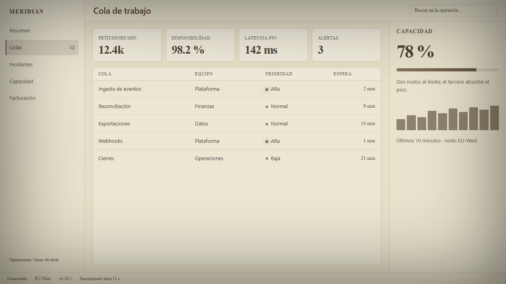

# Visual Engine

Motor universal, local y gratuito para subir la calidad visual de lo que crean los agentes de
IA. Mide una referencia real, la convierte en dirección artística y tokens, construye con
intención, captura el resultado en un navegador real y compara ambos con números que puede
auditar cualquiera.

> **Estado: 1.0.0-rc.1 — release candidate.** Verificado en **Windows 11** con **63 pruebas**
> (código de salida 0, 221 s), **cinco proyectos nuevos** medidos A/B y **cuatro de cinco** pasan
> los gates sin tocarlos. El quinto se publica como rechazo real. La prueba con Codex está
> incluida con su resultado negativo. Nada se declara compatible sin haberlo ejecutado.
> Detalle: [docs/VERIFICACION-1.0.md](docs/VERIFICACION-1.0.md).



## Qué hace de verdad

| Capacidad | Herramienta real | Estado |
| --- | --- | --- |
| Línea temporal: escenas, cortes, fotogramas clave, storyboard | FFmpeg + barrido RGB propio | Verificado |
| Movimiento de cámara: paneo, zoom, rotación, temblor | Correlación normalizada | Verificado |
| Composición, formas, texto y profundidad | JS propio + Tesseract opcional | Verificado / estimado declarado |
| Biblioteca de efectos | 58 recetas Canvas/WebGL/CSS, 12 categorías | Verificado 58/58 |
| Dirección artística | `ve art`: 15 estilos, tokens DTCG, tipografía, materiales | Verificado 15/15 |
| 20 composiciones | `ve showcase --measure` | Verificado 20/20 |
| Reference-to-Design y Reference-to-Effects | `ve refdesign`, `ve refeffects` | Verificado con render real |
| Visual Critic y Debugger | `ve critic`, `ve debug` sobre DOM real | Verificado |
| Fidelidad, gates y loop con reversión | `ve fidelity`, `ve gate`, `ve loop` | Verificado |
| Instalador universal | `ve install` / `agents` / `repair` / `uninstall` | Verificado con ciclo completo |
| Compatibilidad | 9 agentes con formato real | Handshake MCP + autonomía real en OpenCode y Codex |
| Perfiles | `lite`, `professional`, `cinematic` | Verificado |
| Activación y consumo | señal, confianza, opt-out; tokens medidos/estimados | Verificado |
| Seguridad | loopback, contención de rutas, sin shell libre, copias | Verificado; Windows |

## Evidencia visual 1.0-rc

Cinco proyectos nuevos, cada uno con una referencia CC0 independiente. **A** es una plantilla
genérica con el mismo copy; **B** usa dirección artística, paleta derivada, contraste WCAG y
movimiento. Una sola pasada por proyecto, sin cambiar fórmulas, pesos ni umbrales.

| Proyecto | Calidad A → B | Fidelidad A → B | Gates |
| --- | ---: | ---: | --- |
| [Landing premium](docs/evidencia/1.0-rc/projects/premium-landing/captures/after.png) | 75,9 → **86,2** | 72,5 → **80,1** | reject → **accept** |
| [Aplicación de escritorio](docs/evidencia/1.0-rc/projects/desktop-app/captures/after.png) | 68,1 → **89,7** | 65,0 → **93,4** | reject → **accept** |
| [Interfaz cinematográfica de juego](docs/evidencia/1.0-rc/projects/game-cinematic/captures/after.png) | 73,3 → **77,7** | 63,5 → **71,6** | reject → **reject** |
| [Escena 3D interactiva](docs/evidencia/1.0-rc/projects/scene-3d/captures/after.png) | 80,5 → **83,8** | 75,2 → **77,2** | reject → **accept** |
| [Motion graphics](docs/evidencia/1.0-rc/projects/motion-graphics/captures/after.png) | 73,2 → **86,9** | 71,4 → **90,5** | reject → **accept** |

**Fidelidad temporal: 37,6 → 76,6/100** (0.6 obtuvo 59,2). Referencia de 6,00 s y 25 fps; el
resultado corta a 1,84 y 3,84 s frente a 2,00 y 4,00 s de la referencia, con F1 de cortes 0,8.
Vídeos reales en [docs/evidencia/1.0-rc/motion](docs/evidencia/1.0-rc/motion).

**WebGL real:** 1,49° medidos frente a 1,5° esperados, error 0,01°, 184 frames, escena
interactiva con arrastre. `camera.rotation.y` se lee del objeto de cámara, no de una captura.

**El rechazo se publica.** La interfaz de juego sube calidad y fidelidad pero el gate la rechaza
por coherencia de matiz: la referencia CC0 es casi gris y el HUD no reproduce su distribución de
matiz. No se tintó la página para aprobar el gate. Es el comportamiento correcto del gate.

## Prueba con un agente real (Codex)

Tarea nueva e idéntica para los dos brazos: una landing de HALO FOUNDRY a 1280×720, CSS
autocontenido. Mismo modelo, prompt, sandbox y directorio temporal; la única diferencia es
Visual Engine.

| | A sin VE | B con VE |
| --- | ---: | ---: |
| Calidad global | **77,1** | 62,3 |
| Fidelidad | **72,8** | 48,4 |
| Gates | reject | reject |
| Invocaciones de VE | 0 | **9 comandos `ve`** |

**Resultado negativo, publicado.** B invocó de verdad `ve doctor`, `context`, `effects list`,
`vision status`, `agents`, `art` y `capture`, y leyó la skill instalada; aun así su página —un
split oscuro con una vasija en CSS— puntuó peor que la de A, porque la composición medida se
aleja de la referencia clara. Es una limitación del proxy estructural, no una prueba de que VE
empeore el diseño: hace falta revisión artística humana. Detalle y capturas en
[docs/evidencia/1.0-rc/agents](docs/evidencia/1.0-rc/agents).

## Instalación

El repositorio **no está publicado**. Los instaladores aceptan la URL del remoto.

```bash
git clone <url-del-repositorio> visual-engine
cd visual-engine
npm ci
npm run build
npm link
npx playwright install chromium
ve doctor
```

```powershell
powershell -ExecutionPolicy Bypass -File install\install.ps1 -Repo <url> -Ref main
# Linux/macOS: VE_REPO=<url> ./install/install.sh --no-link
ve update
```

Requisitos: **Node 20+**, **FFmpeg/FFprobe** en PATH, **Git** y Chromium de Playwright
(~130 MB). Opcional: Ollama con un modelo de visión y/o Tesseract. Sin cuentas ni APIs de pago.

Ciclo de instalación verificado: instalar → actualizar → reparar → desinstalar, con respaldos,
manifiesto y desinstalación limitada a lo gestionado.

## Uso en dos minutos

```bash
ve doctor
ve analyze referencia.mp4 --samples 12
ve timeline referencia.mp4 --out ./analisis --storyboard
ve spec referencia.mp4 --out ./analisis
ve art "estudio de cerámica editorial" --style editorial --out ./sistema
ve effects apply aurora-hero --out ./mi-web
ve review --reference referencia.mp4 --target-dir ./mi-web --out ./out/revision
ve critic --reference ref.png --target-dir ./mi-web --brief "landing premium"
ve gate --from ./inteligencia/intelligence.json --require-human
ve context "landing cinematográfica" --max-recipes 3
```

El ciclo completo —medir, construir, capturar, criticar, corregir y revertir si empeora— está en
[docs/CLI.md](docs/CLI.md). `ve review` escribe `report.md`, capturas, `diff/heatmap.png` y el
fotograma de referencia.

## Agentes compatibles

| Agente | Instrucciones | MCP | Activación | Verificado |
| --- | --- | --- | --- | --- |
| OpenAI Codex | `AGENTS.md` + skill | TOML `[mcp_servers.visual-engine]` | condicional | binario, handshake y sesión real |
| Claude Code | `CLAUDE.md` + skill | `.mcp.json` | automática por skill | binario y handshake; sesión con `api_error` del proveedor |
| Cursor | regla `.mdc` | `.cursor/mcp.json` | condicional | binario y handshake; sin sesión autónoma |
| Gemini CLI | `GEMINI.md` | `.gemini/settings.json` | condicional | **ausente** en esta máquina |
| Freebuff | `AGENTS.md` + skill | no documentado; no se inventa | automática por skill | binario y skill; sin sesión no interactiva |
| OpenCode | `AGENTS.md` | `opencode.json` | condicional | sesión autónoma real (0.6) |
| MAEX | `AGENTS.md` | TOML compatible, sin verificar | manual | lanzador interactivo detectado |
| Ollama | prompt de sistema | no implementa MCP | manual | HTTP real, modelos listados |
| Cliente MCP genérico | `AGENTS.md` | bloque `mcpServers` | manual | handshake MCP |

Instalación selectiva:

```bash
ve agents                              # estado real: diseñado ≠ instalado ≠ verificado
ve install --agents claude,cursor --yes
ve install --global --allow-global --agents codex --yes
ve repair --yes
ve uninstall --yes
```

Para agentes **sin activación automática** hay una guía de tres líneas en
[docs/AGENTES.md](docs/AGENTES.md#sin-activación-automática). En Codex, `codex exec` deniega MCP
salvo que se añada `-c mcp_servers.visual-engine.default_tools_approval_mode="approve"`; está
documentado y probado.

## Arquitectura

```
src/core   análisis, media, cámara, timeline, inspección, efectos, spec,
           composición, refeffects, galería, benchmark, visión, calidad,
           temporal, iteración, instalador, agentes, perfiles, seguridad
src/mcp    servidor MCP (stdio, 44 herramientas)
src/api    API HTTP local (loopback)
src/cli    comandos `ve` (47)
library/   58 recetas, 20 composiciones, fuentes OFL, benchmarks
docs/      guías, verificación por versión y evidencia medida
tests/     63 pruebas (núcleo, 0.3, 0.4, 0.5, 0.6, 1.0, CLI, API, MCP, E2E)
```

Detalle y decisiones: [docs/ARCHITECTURE.md](docs/ARCHITECTURE.md).

## Pruebas

```bash
npm test        # build + 63 pruebas, ~3 min
```

Cubren análisis y cortes, comparación, CLI, 58 efectos, composición, galería, OCR, API, MCP real,
los 15 estilos, 20 composiciones, critic, gates, debugger, fidelidad, loop con restauración,
instalador con respaldos y desinstalación, handshake MCP, activación, perfiles, tokens, seguridad,
**procesos huérfanos tras un timeout** y el E2E que exige que la versión final supere a la base.

## Limitaciones

- **Windows solamente ejecutado.** Linux/macOS tienen flujo y CI preparados, no verificados.
- **Objetos y pose:** no hay detector semántico; sólo saliencia. Profundidad por proxy.
- **Composición y coherencia** son proxies estructurales. Pueden penalizar un diseño válido que
  se aleje de la referencia, como ocurrió en el A/B con Codex.
- **Aprobación artística humana pendiente** en los cinco proyectos y en el A/B de agentes.
- **Referencias:** obras CC0 del MET como dirección visual, no capturas de producto. El vídeo de
  referencia es un montaje derivado, no una pieza externa licenciada.
- **Tokens** estimados por caracteres; no hay telemetría del proveedor.
- **`npm audit`:** una alerta alta en `zod` (<4.6.6, agotamiento de memoria con colecciones
  enormes). El SDK de MCP usa zod 3; subir a 4 es incompatible y no se ha hecho. El servidor es
  local, por stdio y con esquemas estáticos. Ver [SECURITY.md](SECURITY.md).
- **Publicación:** no se ha publicado en GitHub ni se ha ejecutado `git push`.

Lista completa y honesta: [docs/CAPABILITIES.md](docs/CAPABILITIES.md).

## Licencias

Código propio: MIT. Three.js MIT, Motion MIT, Playwright Apache-2.0, GSAP licencia estándar (sin
plugins de Club), Remotion License (no MIT), mediabunny MPL-2.0, FFmpeg según build, React Bits
MIT/CC-BY. Visual Engine no incluye componentes de terceros copiados. Tesseract y Ollama son
opcionales y no se redistribuyen. Ver [NOTICE.md](NOTICE.md).
